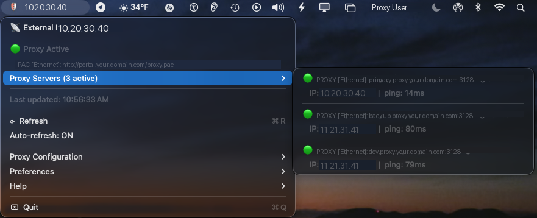

# 🛡️ MacProxyMenuBar

Installs as `/Applications/MacProxyMenuBar.app` (called SimpleProxyMenuBar
before 2026-11-18; `build.sh` removes the old copy, settings carry over). The
Xcode project and target keep the old `SimpleProxyMenuBar` name.

A lightweight native macOS menu bar app that shows your **current proxy IP address** at a glance.

> ⚠️ **Disclaimer:** This software is provided "as is", without warranty of any kind. The author(s) are not liable for any damages or issues arising from the use of this software. Use at your own risk. See [LICENSE](LICENSE) for full details.

> 🤖 **AI Disclosure:** This project was created with assistance from [Claude](https://claude.ai) by Anthropic.

---

## Features

- **Native Swift** — no dependencies, no Python, no Electron
- Detects proxies using `networksetup` — the same tool macOS uses internally
- Checks all network services for HTTP, HTTPS, SOCKS, and PAC proxies
- Icons: **🛡️** proxy active · **🌐** no proxy
- Click the IP item to **copy to clipboard**
- Auto-refreshes every 30 seconds (toggle on/off)
- Manual refresh with ⌘R
- Reverse DNS hostname lookup
- **🩺 Run Diagnostics… (⌘D)** — does the proxy setup actually work? Runs
  automatically after **Save & Enable** of a PAC URL:
  1. **PAC fetch** — HTTP status, size, time; flags a failed download or a file
     that isn't a PAC (no `FindProxyForURL`)
  2. **PAC evaluation** — runs the PAC through macOS's own engine for each test
     URL and shows `DIRECT` or `PROXY host:port` (and PAC script errors)
  3. **Proxy reachable** — TCP connect to each proxy's port (not ping)
  4. **Proxy works** — a real HTTPS request through each proxy (spots 407/403)
  5. **Egress** — public IP direct vs through the system vs per proxy, and
     whether traffic really goes where the PAC says
  6. **Effective settings** — PAC, WPAD, manual proxies and bypass list as
     macOS applies them now
  - **Local Network permission** — whether macOS lets this app reach LAN
    addresses (macOS 15+ privacy). Denied shows as ❌ with the fix, instead of
    every LAN proxy failing with "Network is down"; waits ~10 s in case the
    Allow prompt is on screen. **Local Network Settings…** in the window opens
    the pane. Browsers need their own permission, which can't be checked or
    granted from here. The app also touches the LAN once at launch so macOS
    asks right after install.
  Results open in a window with **Copy Report**; the menu shows the last
  result. Test URLs are editable under **Proxy Configuration → Set Diagnostic
  Test URLs…** (add an internal host to check it goes DIRECT).
- **PAC URL follows the system** — on launch and every time the menu opens,
  the app reads the PAC URL macOS is using and shows it with its source:
  **from system** (set outside the app — System Settings, `networksetup`,
  Ansible) or **entered manually** (via Set PAC URL…). A Save Only URL that
  isn't applied yet also shows **System is using: …**. When the system PAC
  changes outside the app, the system wins, so Enable Auto Proxy never
  re-applies a stale URL.
- **Preferences** → Open at Login toggle
- **Help** → link to GitHub
- Hides from Dock (`LSUIElement`) — lives only in the menu bar

## Requirements

- macOS 12.0+
- Xcode 15+

## Setup

```bash
git clone https://github.com/baldwinsung/proxy-menubar.git
cd proxy-menubar
open SimpleProxyMenuBar.xcodeproj
```

1. In Xcode, go to the **SimpleProxyMenuBar** target → **Signing & Capabilities**
2. Set your **Team**
3. Press **⌘R** to build and run

## Build & Install to /Applications

```bash
./build.sh
```

Builds a Release binary with `xcodebuild` and installs it to `/Applications` using `ditto`.

## Project Structure

```
SimpleProxyMenuBar/
├── SimpleProxyMenuBar.xcodeproj/
│   ├── project.pbxproj
│   └── xcshareddata/xcschemes/
│       └── SimpleProxyMenuBar.xcscheme
├── AppDelegate.swift       # Menu bar UI, preferences, help
├── ProxyChecker.swift      # Proxy detection + IP fetching
├── Diagnostics.swift       # Run Diagnostics checks + report window
├── main.swift              # Entry point
├── Assets.xcassets/        # App icon and accent color
├── build.sh                # Build and install to /Applications
├── LICENSE
└── README.md
```

## Screenshots

| Menu bar | Proxy configuration | Proxy server list |
|---|---|---|
|  |  |  |

## How Proxy Detection Works

Iterates every network service from `networksetup -listallnetworkservices` and checks:

```bash
networksetup -getautoproxyurl       "$svc"   # PAC
networksetup -getwebproxy           "$svc"   # HTTP
networksetup -getsecurewebproxy     "$svc"   # HTTPS
networksetup -getsocksfirewallproxy "$svc"   # SOCKS
```

If any service reports `Enabled: Yes`, the proxy is shown as active with its host, port, and service name — e.g. `HTTPS [Wi-Fi]: 127.0.0.1:7890`.

## Set up your proxy

Manage your proxy via pac ( proxy auto config ) file. Use scripts at https://github.com/baldwinsung/scripts_apple_mac/tree/main/proxy to get setup.

## License

MIT — see [LICENSE](LICENSE). Free to use, modify, and distribute.

## Disclaimer

This software is provided without warranty. The author(s) accept no liability for any damages, data loss, security issues, or other problems arising from the use of this software. It is your responsibility to ensure it is suitable for your use case.
